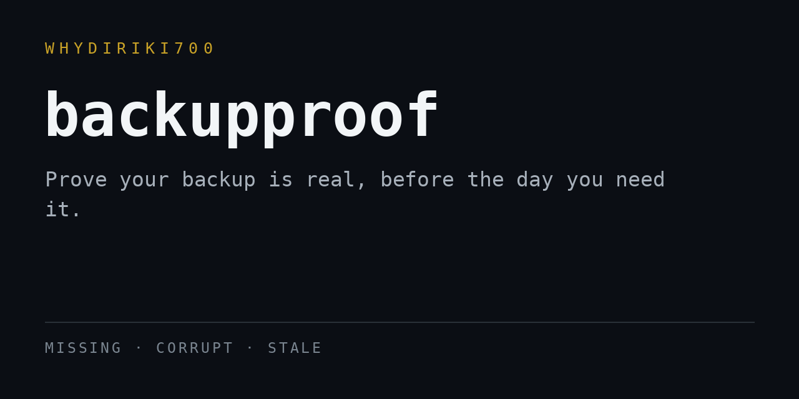

# backupproof

Most backups are a feeling, not a fact. backupproof compares a backup with
its source and gives a verdict you can act on: PROVEN, or NOT PROVEN with
the reasons listed.

## What it checks

- Files missing from the backup
- Files whose size differs, and with `--hash`, files whose content differs
  even at the same size
- Zip integrity: every member of a .zip backup must pass its CRC check
- Freshness: the newest file in the backup against a maximum age you set
- Extra files in the backup are reported as a note, not a failure

The backup can be a folder or a .zip file. The source is a folder.

## Usage

```
python -m backupproof ~/Documents ~/backups/documents.zip --hash
python -m backupproof ~/Documents ~/backups/documents --max-age-hours 48 --hash --json
```

Exit code 0 means PROVEN, 1 means NOT PROVEN, 2 means the check itself
could not run.

## Example

```
source files: 128  backup files: 127  backup age: 3.25 hours
NOT PROVEN:
  - 1 files missing from backup
  - backup is 3.2 hours old, over the 2 hour limit
```

## Tests

```
python -m unittest discover -s tests
```

Zero dependencies. Python 3.9+. MIT license.
